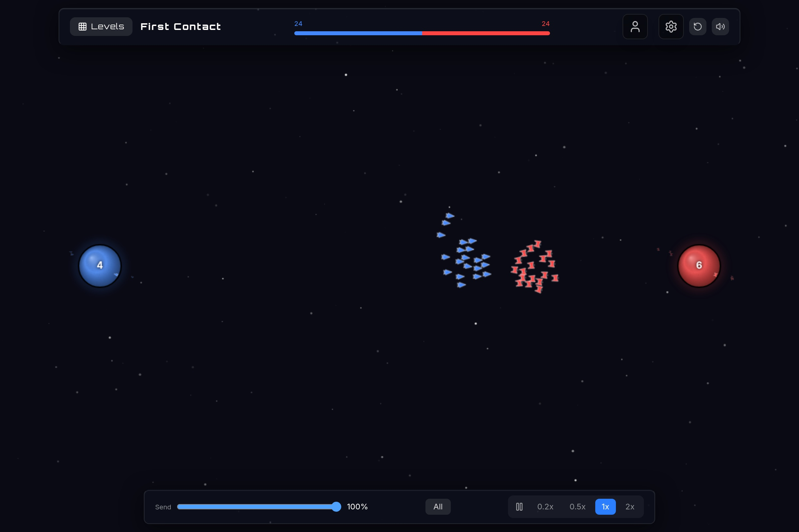
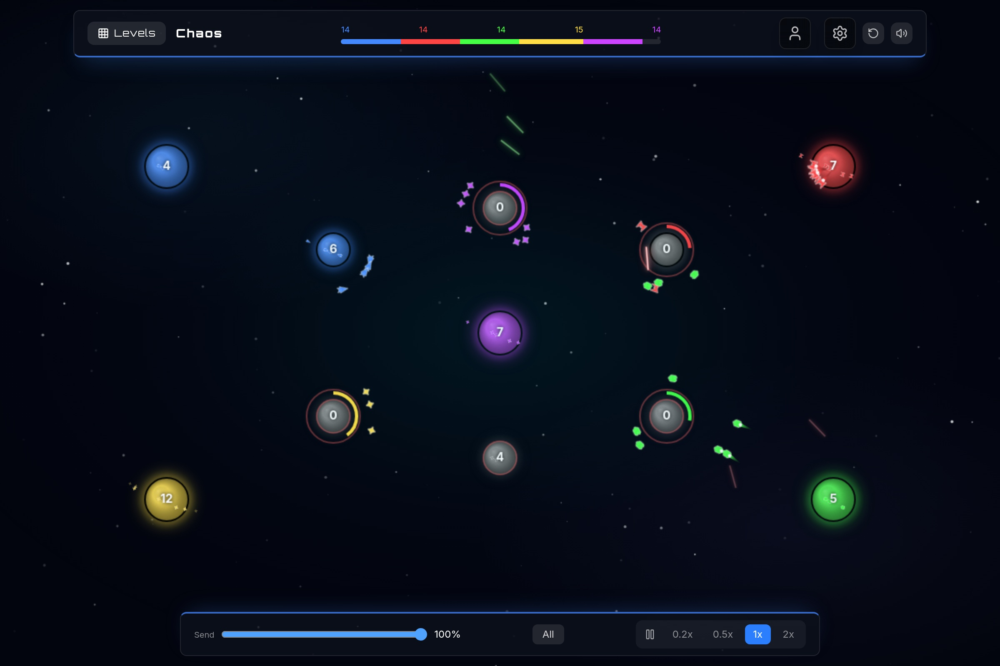
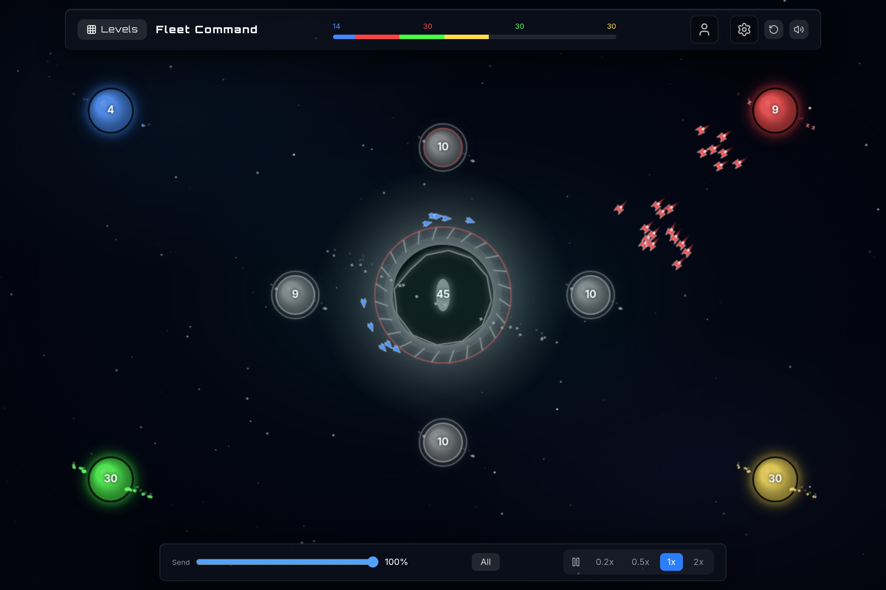
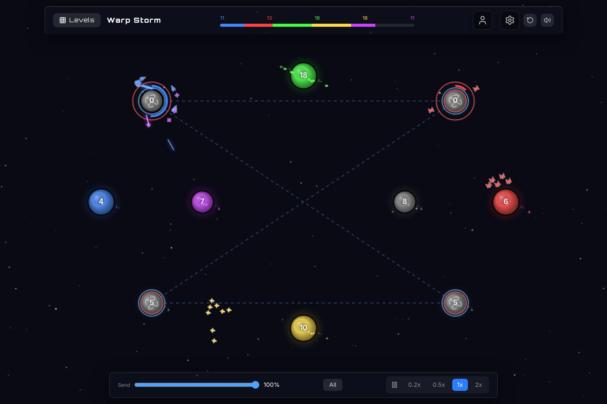
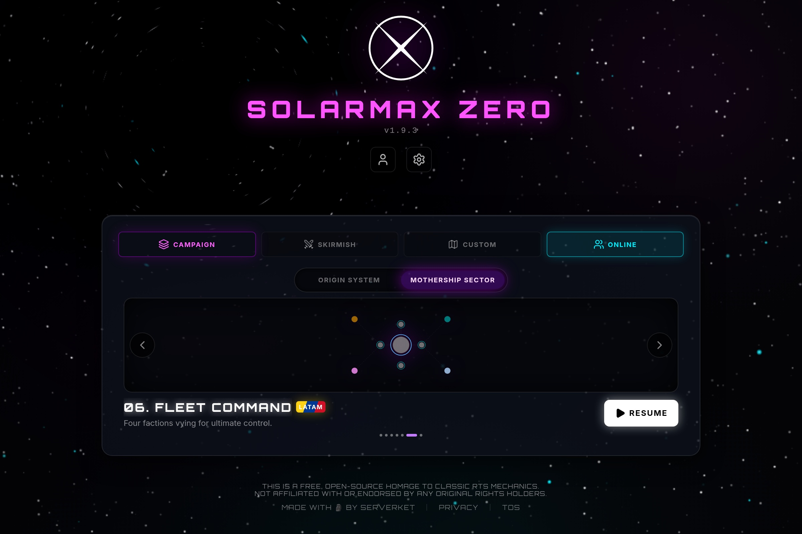
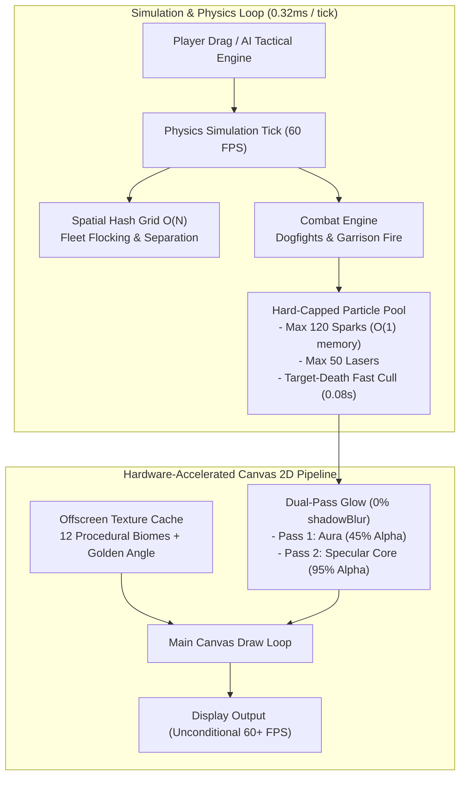
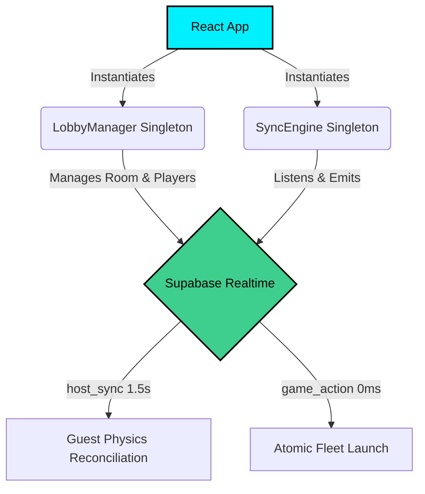
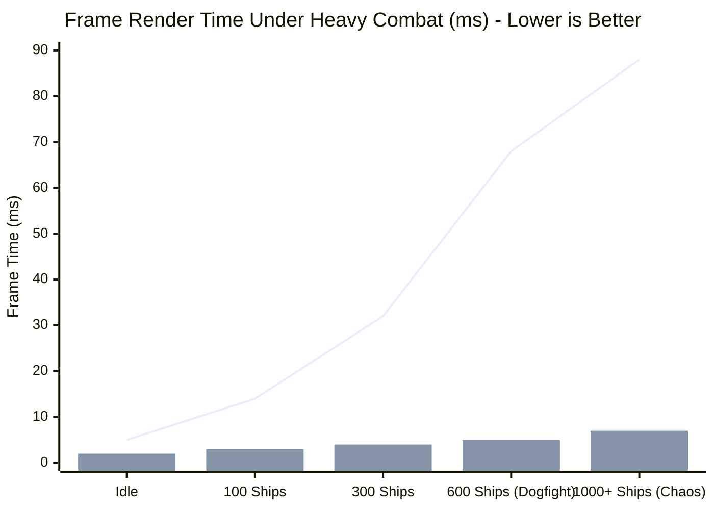

<div align="center">
  
  <h1>Solarmax Zero</h1>
  <p><strong>A high-fidelity, offline-first PWA reimagining of the classic RTS gameplay.</strong></p>
  <p>
    <a href="LICENSE"></a>
    <a href="package.json"></a>
    
    
    
    
    
  </p>
</div>

<br/>

Solarmax Zero is a highly optimized web-based reimagining of the classic Solarmax real-time strategy gameplay. It features true flocking mechanics, offscreen canvas entity caching, 12 procedural planet biomes with golden-angle axial dispersion, a zero-shadowBlur dual-pass hardware rendering pipeline, advanced AI portal routing, and offline PWA capabilities.

> **Original Concept & Inspiration**: Inspired by classic RTS mechanics created by the talented indie developer **[Nico Tuason](https://x.com/nicotuason)**. This project is a passionate fan-made architectural reimagining built for the modern web.

> **Original Soundtrack (OST)**: Space Ambient tracks generously provided by **[Stellardrone](https://stellardrone.bandcamp.com/)** under the Creative Commons BY 3.0 license. Album: *Light Years*.

## 📸 Gameplay & Visuals

<table>
  <tr>
    <td width="50%">
      <a href="./promo/itch/screenshot-1.jpg"></a>
      <p align="center"><sub><b>1v1 Tactical Duel (First Contact)</b></sub></p>
    </td>
    <td width="50%">
      <a href="./promo/itch/screenshot-2.jpg"></a>
      <p align="center"><sub><b>4-Faction Galactic Clash (Chaos)</b></sub></p>
    </td>
  </tr>
  <tr>
    <td width="50%">
      <a href="./promo/itch/screenshot-3.jpg"></a>
      <p align="center"><sub><b>Colossal Mothership Battle & Defense Turrets</b></sub></p>
    </td>
    <td width="50%">
      <a href="./promo/itch/screenshot-5.jpg"></a>
      <p align="center"><sub><b>Hyperspace Warp Portals (Warp Storm)</b></sub></p>
    </td>
  </tr>
  <tr>
    <td colspan="2" width="100%">
      <a href="./promo/itch/screenshot-4.jpg"></a>
      <p align="center"><sub><b>Galactic Sector Navigation & Mission Hub</b></sub></p>
    </td>
  </tr>
</table>

## 🏷️ Project Versioning

This project adheres to Semantic Versioning (SemVer) with a unified standard:
- Major versions (1.0.0) indicate major rewrites or new mechanic overhauls.
- Minor versions (0.1.0) indicate new features (new ships, planets, modes).
- Patch versions (0.0.1) indicate bug fixes, engine optimizations, or balance adjustments.

## ⚙️ Core Mechanics & Architecture

### 🪐 1. 12-Biome Procedural Planet Engine & Golden Angle Dispersion
- **12 Distinct Biomes**: Every celestial body renders procedural surface shaders: *Earthlike, Volcanic, Barren, Crystalline, Gas Giant, Bioluminescent, Desert Dune, Ice Crust, Cyber Grid, Oceanic Abyss, Toxic Swarm,* and *Plasma Storm*.
- **Golden Angle ($137.5^\circ$) Axial Dispersion**: Planetary rotation axes are distributed via Fibonacci golden-angle offsets ($137.5^\circ \times \text{index}$), ensuring adjacent planets never look identical.
- **Universal Texture Engine & 0ms Fallback**: Pre-populates in-memory 512x512 procedural canvas textures for all 12 biomes on mount (`src/utils/assets.ts`). Planets render instantaneously (0ms latency) without ever appearing as blank spheres, with authentic PNGs progressively enhancing the visual fidelity once loaded.
- **Zero-Cost Offscreen Cache**: Planet textures, atmosphere rims, and 3D spherical gradients are pre-baked into offscreen canvases upon initialization. During active combat, planets render instantly via native `drawImage` calls with 0ms rasterization overhead.

### ⚡ 2. Zero-ShadowBlur Dual-Pass GPU Glow Engine
- **The Problem**: Traditional Canvas 2D glow relying on `ctx.shadowBlur` forces the browser compositing engine to execute CPU/GPU Gaussian blur passes for every laser and spark, causing severe stutter (40–80ms frame spikes) in large dogfights.
- **The Solution**: An ultra-fast **dual-pass glow pipeline**:
  - **Pass 1 (Saturated Aura)**: Broad stroke with faction color at 45% alpha creating an ambient bloom field.
  - **Pass 2 (Specular Core)**: Crisp, high-intensity stroke at 95% alpha with high specular brightness.
- **Result**: Indistinguishable visual neon bloom at unconditional 60+ FPS, consuming less than 5ms total frame time.

### 🛸 3. Spatial Hashing Flocking & Memory-Capped Particles
- **Spatial Hash Grid ($O(N)$)**: Ships in transit utilize a spatial hash grid (`src/engine/physics.ts`) to calculate flocking behaviors (Separation, Cohesion, Alignment) without quadratic $O(N^2)$ distance checks.
- **Hard Particle Caps**:
  - `MAX_SPARKS = 120`: Eradicated the exponential particle doubling bug ($2^N$ spark creation). Spark generation is strictly clamped.
  - `MAX_LASERS = 50`: Eliminates beam pileups during massive 100v100 skirmishes.
  - **Rapid Laser Dissipation**: When a targeted ship is destroyed, laser lifespan immediately drops to $\le 0.08\text{s}$, clearing phantom projectiles and memory instantly.

### 🛠️ 4. Fluid Responsive Map Editor Studio
- **Adaptive Screen Ergonomics**: The editor toolbar adapts fluidly across viewports from 800px mobile/netbook screens to 4K displays.
- **Responsive Toolbar Architecture**:
  - Compact screens (<1280px) display crisp icon buttons with dedicated badges.
  - Desktop displays ($\ge 1280\text{px}$) expand with full typographic tool descriptions.
  - Includes a dedicated `MousePointer` select tool and clean `.no-scrollbar` styling.
  - Center-aligned layout without negative coordinate flex clipping.

### 🤖 5. Tactical AI & Tug-of-War Supremacy
- **Tactical Valuation**: AI evaluates targets based on proximity, defense garrison strength, and strategic ownership. It dynamically reinforces under-siege planets from backline reserves.
- **Capture Decay**: Contested planets slowly drain capture progress rather than instantly snapping to neutral, enabling intense tug-of-war maneuvers.

### 🌐 6. Supabase Realtime Multiplayer
- **Architecture**: Replaces unstable WebRTC P2P mesh with **Supabase Realtime Broadcast Channels** (`room:XXXXXX`).
- **State Reconciliation**: The Host runs the authoritative simulation and broadcasts periodic `host_sync` ticks (every 1.5s). Guests receive `host_sync` and smoothly interpolate their local planet states (`owner`, `ships`), masking latency gaps.
- **Atomic Execution**: Moves execute locally with 0ms feel and broadcast with unique per-tab identifier prefixing (`TAB_INSTANCE_ID`), preventing session collisions.

---

## 📈 Performance & Pipeline Visualizations

### Simulation & Rendering Pipeline


### Multiplayer & Synchronization Architecture


### Frame Render Time Under Heavy Combat


### Performance Matrix

| Metric | Legacy Implementation | Current Engine (v1.9.9) | Gain |
| :--- | :--- | :--- | :--- |
| **Physics Tick Time** | 2.80 – 8.50 ms | **0.326 ms** | **~88% faster execution** |
| **Canvas Blur Overhead** | 35 – 75 ms (`shadowBlur`) | **0.00 ms** (Dual-Pass Glow) | **100% eliminated** |
| **Spark Particle Scaling** | Uncapped ($2^N$ duplication bug) | Capped at **120 max** | **Infinite loop / OOM immunity** |
| **Laser Projectile Pool** | Unbounded (400px trails) | Capped at **50 max** + 0.08s cull | **Zero clutter, 0ms lag** |
| **Planet Textures** | 1 generic palette | **12 distinct procedural biomes** | **Infinite visual diversity** |
| **Texture Availability (Frame 0)** | Stale / Blank spheres on CDN lag | **0ms instantaneous procedural texture** | **Zero blank planets (100% reliable)** |
| **Automated Unit & Perf Suite** | 0 tests | **44 tests / 2,383 assertions** | **100% passing across 9 test suites** |
| **Map Editor Ergonomics** | Cut off on <1300px screens | **Fluid Responsive (800px – 4K)** | **Seamless editing anywhere** |

---

## 🚀 Build, Run & Distribution

### Local Development & Testing
```bash
bun install
bun test        # Runs full 44-test suite across 9 modules (assets, physics, levels, mapEditor, performance, ai, superweapons, storage, multiplayer)
bun run lint    # Oxlint code quality validation
bun run dev     # Starts local development server
```

### Packaging for Itch.io (HTML5 Standalone ZIP)
Generates `release/solarmax-zero-itch.zip` ready for upload, with 100% relative base assets, root-level `index.html`, and portal iframe isolation:
```bash
bun run build:itch
```

### Automated Dual-Target Release
Bumps version, builds the Itch.io standalone package, stages git tags, and pushes to GitHub to trigger Vercel deployment:
```bash
bun run release <version> [--note "release notes"]
```

## :brain: Acknowledgments
_"Whoever loves discipline loves knowledge, but whoever hates correction is stupid."_
